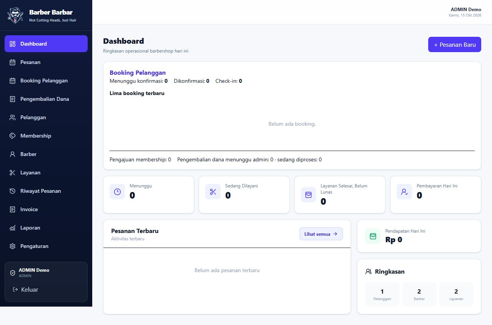
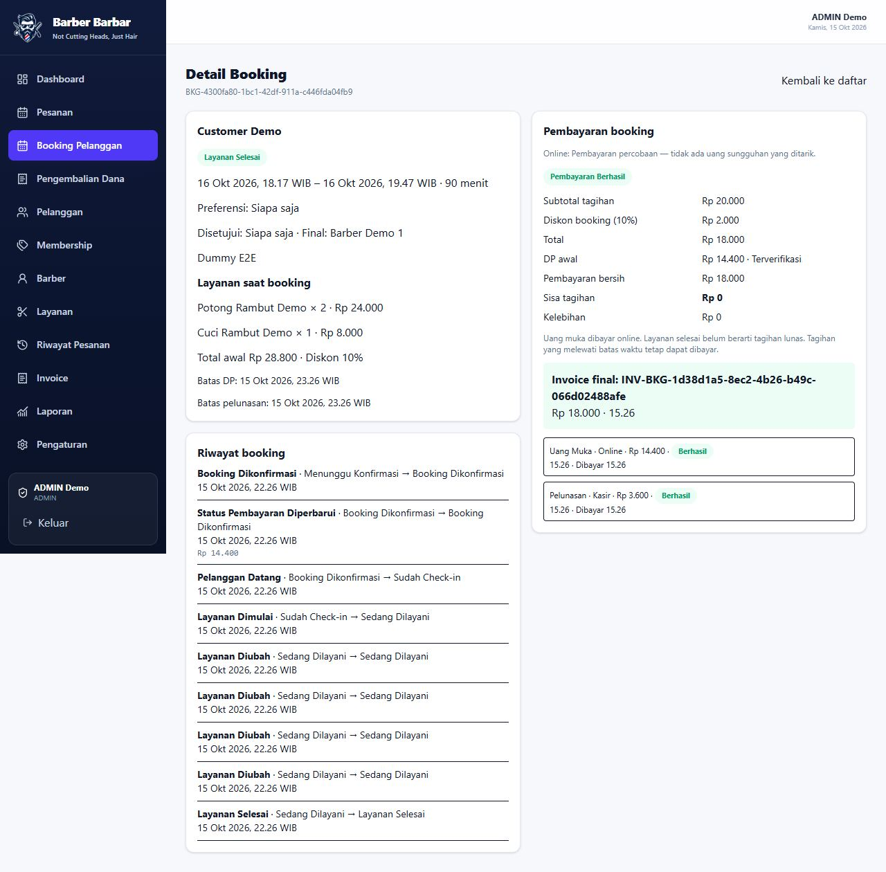

# BARBER BARBAR — Web Management & Backend

Web Management dan backend pusat untuk operasional barbershop, melayani Web ADMIN/STAFF, Mobile Staff, dan Customer Web melalui satu API dan satu database PostgreSQL.

Project untuk **tugas kuliah, pembelajaran Fullstack, portofolio, dan demonstrasi lokal**; bukan aplikasi Production. Hosting berbayar bukan kebutuhan demo. Mobile berhasil menurut laporan pengguna (**USER-REPORTED**); bukti rinci UI native/checkout Android belum lengkap. Email nyata, refund historis dan advisory tetap dicatat jujur. Lihat [acceptance demo](docs/DEMO-ACCEPTANCE.md).

Hasil terbaru ada di [penutupan acceptance](docs/FINAL-ACCEPTANCE-CLOSURE.md):
29 suite teknis lulus, perubahan identitas/password dengan autentikasi ulang,
edit layanan/jumlah pada jadwal ulang, template/transport email mock, serta
perbaikan race edit Web. Delivery email nyata belum aktif; memilih provider dan
mengisi sample environment saja tidak otomatis mengirim email. Detail setup
ada di [panduan reset](server/scripts/RESET-PASSWORD-CUSTOMER.md).

## Teknologi dan fitur

- Web: React, TypeScript, Vite, Tailwind CSS, React Query, Socket.IO.
- Backend: Express, TypeScript, Prisma, PostgreSQL, bcrypt, JWT, Midtrans Sandbox.
- Pelanggan, barber, layanan, membership, pesanan walk-in, kasir, laporan, dan invoice.
- Akun CUSTOMER terpisah dari operator; pengaitan akun dan membership memerlukan keputusan ADMIN.
- Booking multiservice, pemilihan barber, persetujuan usulan, reschedule, pembatalan, dan lifecycle layanan.
- DP/pelunasan berdasarkan database, ledger idempotent, webhook terverifikasi, dan refund melalui ADMIN.
- Scheduler deadline persisten; realtime menjadi sinyal refetch. REST/database tetap sumber data utama.

## Arsitektur dan folder

```text
client/src/pages/          Halaman operasional Web
client/src/components/     Komponen antarmuka
client/scripts/            Integrasi dan browser E2E
server/src/routes/         API customer dan operator
server/src/controllers/    Penanganan HTTP
server/src/services/       Aturan bisnis
server/src/middleware/     Autentikasi dan validasi
server/src/realtime/       Otorisasi dan event Socket.IO
server/prisma/             Schema dan riwayat migration
server/scripts/            Pengujian, backup, dan audit
docs/                      Panduan dan bukti audit
```

Mobile Staff memakai JWT operator. Customer Web memakai sesi guest HttpOnly tanpa registrasi/login atau pemilihan barber; JWT CUSTOMER tetap tersedia untuk kompatibilitas Native historis. Socket guest memakai cookie sesi terverifikasi dan room booking yang ditentukan server; polling REST tetap menjadi fallback. Harga, snapshot diskon, slot, status, pembayaran, dan invoice divalidasi backend. Callback checkout tidak menetapkan PAID.

## Menjalankan lokal

Untuk dependency dan environment yang sudah tersedia, gunakan satu launcher Windows dari folder ini:

```powershell
powershell.exe -NoProfile -ExecutionPolicy Bypass -File .\scripts\jalankan-barberbarbar.ps1 -HanyaBackend
# Tambahkan -Ngrok hanya saat menguji pembayaran; forwarding wajib ke proxy 3001.
# Tambahkan -Periksa untuk pemeriksaan read-only tanpa menjalankan proses baru.
```

Launcher memeriksa identitas backend, memakai port 3000 dan proxy webhook 3001,
serta tidak menghentikan proses existing. Tanpa `-HanyaBackend`, Web Admin (5173), Customer Web (5175), dan
Expo Staff (8081) dijalankan bila port kosong. Customer Native dipensiunkan;
source dan endpoint historis tetap dipertahankan. Panduan pemulihan status, hasil pengujian
dan batas webhook laptop ada di [audit pembayaran dan antarmuka](docs/PAYMENT-WEBHOOK-UI-COPY-AUDIT.md).

Persyaratan: Node.js/npm sesuai lockfile (baseline Node 24), PostgreSQL, serta `pg_dump`/`pg_restore` untuk backup. Database existing memerlukan konfigurasi pemilik. Dari `server`, pasang dependency lalu buat `.env` berdasarkan `.env.example`:

```powershell
npm.cmd ci
npm.cmd run prisma:generate
node node_modules/prisma/build/index.js validate
node node_modules/prisma/build/index.js migrate status
npm.cmd run build
npm.cmd start
```

Development: `npm.cmd run dev`. Backend memakai port 3000 secara default; periksa `GET http://127.0.0.1:3000/public/services`. Tinjau migration sebelum menyiapkan database baru. Jangan menjalankan reset atau seed demo pada data existing.

Dari `client`, pada terminal lain:

```powershell
npm.cmd ci
npm.cmd run dev -- --host 127.0.0.1
```

Buka `http://127.0.0.1:5173`. Vite meneruskan `/api` dan `/socket.io` ke backend yang sama. Build Web: `npm.cmd run build`.

## Environment

Isi credential secara manual di `server/.env`; file asli diabaikan Git. Jangan memasukkan credential server ke bundle Web atau `EXPO_PUBLIC_*`.

| Variabel | Kegunaan |
|---|---|
| `DATABASE_URL` | Koneksi PostgreSQL lokal |
| `JWT_SECRET` | Secret panjang dan acak untuk JWT |
| `PORT` | Port backend, default 3000 |
| `MIDTRANS_MERCHANT_ID` | Identitas merchant Sandbox |
| `MIDTRANS_SERVER_KEY`, `MIDTRANS_CLIENT_KEY` | Credential Sandbox, hanya di server |
| `MIDTRANS_IS_PRODUCTION` | `false`; Production belum diaktifkan |
| `SOCKET_ALLOWED_ORIGINS` | Origin Web yang diizinkan, dipisahkan koma |
| `SCHEDULER_BOOKING_AKTIF` | Default aktif; dapat dimatikan untuk inspeksi terkontrol |
| `SCHEDULER_BOOKING_INTERVAL_MS` | 1.000–60.000 ms, default 15.000 |

Konfigurasi webhook dan batas provider: [panduan Midtrans](docs/audit/F7-SANDBOX.md). Forgot-password belum mengirim email; token tidak dikembalikan endpoint publik.

## Pengujian dan backup

Jalankan pada database uji lokal kosong yang terpisah, dengan schema ditinjau dan backup terbaru. Override DATABASE_URL hanya untuk proses pengujian; jangan arahkan runner ke data aplikasi. Runner memeriksa 22 model sesudah setiap tahap. Hasil baru berada di `server/artifacts/` yang diabaikan Git.

```powershell
# Dari server; MIDTRANS_IS_PRODUCTION=false
node scripts/backup-e2e.mjs
node scripts/jalankan-regresi-e2e.mjs
node scripts/verifikasi-integritas-e2e.mjs "<folder-backup>"
```

Backup privat berada di `%LOCALAPPDATA%/BARBERBARBAR/database-backups`, di luar Stage 2. Dump, snapshot, environment asli, dan patch privat tidak boleh diunggah. Detail: [panduan pengujian](docs/PENGUJIAN.md).

## Integrasi dan dokumentasi

- [Web Management + Backend](https://github.com/umarmaulanazakaria/barberbarbar)
- [Mobile ADMIN/STAFF](https://github.com/umarmaulanazakaria/barberbarbar-mobile)
- Customer Web aktif: folder `../barberbarbar-customer-web`, http://127.0.0.1:5175
- [Customer Web](https://github.com/umarmaulanazakaria/barberbarbar-customer); riwayat Native tersedia pada branch historis dan backup privat.
- [Keputusan migrasi Customer Web](docs/CUSTOMER-WEB-UTAMA.md)
- [Integrasi Socket.IO dan Midtrans](docs/INTEGRASI-SOCKET-MIDTRANS.md)
- Akses Customer Web melalui HP: `../barberbarbar-customer-web/docs/AKSES-HP-LAN.md`. Origin REST/socket development mengikuti IP privat adapter laptop pada port5175; Production tetap memakai allowlist eksplisit.
- [Panduan ekosistem](docs/README-FINAL.md), [pengujian Android](docs/README-PENGUJIAN-ANDROID.md), [demo](docs/PANDUAN-DEMO.md).
- [Audit finalisasi historis](docs/audit/F14-AUDIT.md), [audit cleanup terbaru](docs/WORKSPACE-CLEANUP-AUDIT.md).

Branch review: `feature/project5-integration`. Build lokal dan provider MOCK tidak menggantikan acceptance perangkat atau pembayaran provider nyata.

## Demonstrasi dan portofolio

[Menjalankan ekosistem](docs/PANDUAN-JALANKAN-DEMO.md) | [Presentasi](docs/PANDUAN-PRESENTASI.md) | [Naskah](docs/NASKAH-DEMO.md) | [Review Git/PR](docs/PORTFOLIO-RELEASE-REVIEW.md).

### API utama

| Kelompok | Fungsi dan akses |
|---|---|
| GET `/public/services`, `/public/barbers` | Katalog aktif tanpa login, atribut publik saja |
| `/auth/customer/*`, `/customer/membership`, `/customer/bookings` | Akun, profil dan data milik CUSTOMER |
| `/bookings`, `/orders`, `/customers`, `/services`, `/barbers` | Operasional dengan JWT operator |
| `/membership-requests`, `/refund-requests` | Keputusan khusus ADMIN diperiksa backend |
| POST `/midtrans/notifications` | Webhook dengan signature dan verifikasi provider |

Route -> controller -> service -> Prisma memisahkan HTTP, aturan bisnis dan penyimpanan. PostgreSQL menjadi sumber kebenaran; Socket.IO memberi sinyal refetch REST dalam room berotorisasi.

### Screenshot Web aktual

Web asli di Edge headless dengan fixture database kosong terpisah dan pembayaran **MOCK**. Bukan bukti Android/provider nyata. [Lima gambar dan reproduksi](docs/screenshots/README.md).




