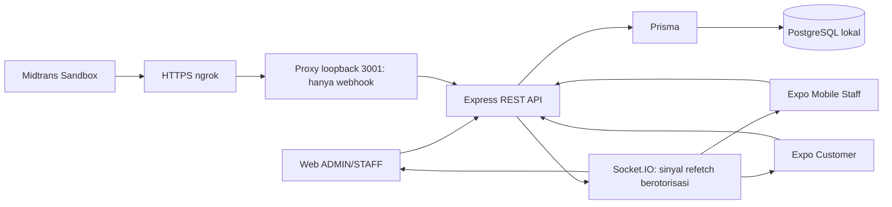

# Panduan presentasi BARBER BARBAR

Tujuan: menjelaskan satu sistem Fullstack untuk tugas kuliah dan demonstrasi lokal, bukan peluncuran Production. Gunakan [naskah](NASKAH-DEMO.md), [startup](PANDUAN-JALANKAN-DEMO.md), dan [acceptance](DEMO-ACCEPTANCE.md).

1. **Perkenalan:** BARBER BARBAR menghubungkan pelanggan, kasir dan staf barbershop.
2. **Masalah:** pemesanan, antrean layanan dan pembayaran yang terpisah menyulitkan pencatatan status.
3. **Tujuan:** menyatukan booking, layanan dan tagihan dalam satu sumber data.
4. **Project 3:** Web Management React untuk ADMIN/STAFF dan backend Express pusat.
5. **Project 4:** React Native/Expo untuk menerima booking, check-in, menentukan barber, memproses layanan dan kasir sesuai peran.
6. **Project 5:** React Native/Expo untuk customer melihat katalog, memesan, mengajukan membership, memantau pembayaran dan riwayat.
7. **Arsitektur:** ketiga antarmuka menggunakan API yang sama; tidak memiliki database sendiri-sendiri.

8. **Database terpusat:** status booking dan ledger tersimpan di PostgreSQL. Transaksi menjaga perubahan terkait tetap konsisten.
9. **REST API:** aplikasi meminta atau mengubah data melalui HTTP. JWT CUSTOMER berbeda dari operator; backend memeriksa pemilik dan peran.
10. **Socket.IO:** memberi tahu ada perubahan, lalu aplikasi mengambil data terbaru melalui REST. Reconnect/refetch memulihkan tampilan; event bukan bukti pembayaran.
11. **Midtrans Sandbox:** lingkungan pembayaran percobaan, bukan uang Production. Callback checkout belum menentukan lunas; backend memverifikasi signature dan kondisi provider.
12. **Booking:** katalog aktif → layanan/jumlah → barber bebas atau pilihan → jadwal → Menunggu Konfirmasi → konfirmasi operator. Harga dan diskon dihitung server.
13. **Operasional:** DP terverifikasi → check-in → barber final → pesanan/IN_SERVICE → perubahan item bila diperlukan → COMPLETED. Jangan melewati prasyarat demi demo.
14. **Pembayaran:** DP dan pelunasan masuk ledger idempotent; tagihan lunas berarti balance nol dan satu invoice final. Refund memerlukan ADMIN; PROCESSING belum berarti berhasil.
15. **Demonstrasi:** Customer → Web → DP → Staff → pelunasan/invoice → reconnect. Tanpa HP, tampilkan Web aktual dan jelaskan batas SDK/adapter; jangan menyebutnya UI Android.
16. **Penutup:** sistem menunjukkan pemisahan peran, transaksi database, REST, realtime dan payment. Email nyata, refund historis, advisory dan bukti native rinci tetap dicatat. Hosting Production bukan target penilaian ini.
